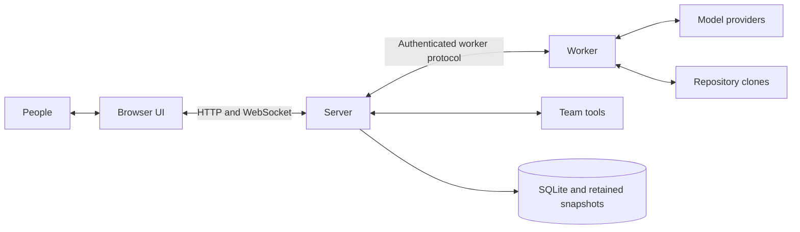

# Architecture

The server owns durable process state. Workers execute assigned turns and report results. The browser displays server-owned state and submits operator commands. You can watch these roles in action in the [retry tutorial](index.md).

## 1. Introduction and goals

Leitwerk coordinates code-defined AI workflows with human decisions and external integrations.

| Goal | Architectural response |
| --- | --- |
| Extensibility | Load processes, tools, providers, and watchers through extension contracts. |
| Visibility | Retain execution history and stream current activity to the browser. |
| Recovery | Reconcile durable process and worker state after interruption. |
| Isolation | Separate worker execution from server storage and credentials. |
| Ordered mutation | Sequence process inputs and serialize lifecycle changes per process. |

Operators launch, review, and recover work. Extension authors define workflow behavior. Core maintainers own coordination, persistence, transport, and the shared UI.

## 2. Constraints

- **POSIX only:** macOS and Linux; Windows is not supported.
- **Hard package boundary:** Core packages under `packages/` never import `extensions/` in runtime code, tests, or types.
- **Single SQLite writer:** The server is the only SQLite writer; workers never access the database.
- **Single instance tree:** Multi-component processes still share one durable instance tree.
- **Deferred extension reactions (ADR-023):** Per-process lifecycle mutations run under exclusive coordination; extension host events emitted during a mutation run after the lock releases.
- **Configuration boundary:** Configuration supplies wiring and runtime defaults, not process graphs, transitions, or actions.
- **Single-server scope:** Per-tenant isolation and multi-server coordination are not implied by authentication or idempotency.

Implementation stack: Fastify (`@fastify/websocket`), SQLite with Drizzle and `node:sqlite`, Svelte 5 + Vite, and `@earendil-works/pi-coding-agent` embedded in workers.

## 3. Context



Extensions connect team tools through server-owned integration calls and polling. Workers receive only the tools and credentials authorized for their work. Repository code and model output are untrusted input, never server configuration.

The server owns OIDC admission and retained authentication claims. Claims remain separate from actors and worker payloads; see [Security](../admin/security.md).

## 4. Solution strategy

Keep decisions pure where possible: graph validation, transition rules, and read-model projection perform no external I/O. Server handlers, worker drivers, and extension event handlers coordinate I/O around those rules.

Workers are disposable execution units, not owners of business state. Their retained workspace and tooling survive worker replacement, but process volumes require independent backups to survive volume loss; see [Backup and upgrades](../admin/backup-and-upgrades.md).

## 5. Building blocks

```likec4-view
containers
```

All 18 workspace packages under `packages/`:

| Package | Responsibility |
| --- | --- |
| `domain` | Durable entities and pure domain rules. |
| `protocol` | HTTP contracts, browser WebSocket frames, forms, launchers, and read models. |
| `worker-protocol` | Server–worker WebSocket IPC messages, snapshots, and worker API version. |
| `process-sdk` | Code-defined processes, `flow.*` builders, tool/watcher/settings/provider/UI extension contracts. |
| `extension-runtime` | Dynamic extension discovery (`jiti`), catalog assembly, and runtime setup. |
| `watcher-utils` | Polling schedules and coordination for extension watchers. |
| `external-writes` | Idempotent `ensure` / `logOnly` external-write contracts and publication receipts. |
| `worker-runners` | Local, Docker, and Kubernetes execution units, volumes, and read-only state exporters. |
| `server` | Fastify HTTP/WS API, `ProcessEngine`, SQLite/Drizzle persistence, auth, and worker supervisor. |
| `worker` | Isolated worker entry, Pi SDK tree driver, workspace prep, and snapshot upload. |
| `ui` | Svelte 5 SPA (Dashboard, Launcher, Chronicle, Turn Rail, Inspector, Settings, Skills, Watchers). |
| `wiki` | Topic solution wiki models, SQLite storage, HTTP routes, tools, and Svelte UI. |
| `workflow-graph` | Pure workflow layout and shared Svelte renderer used by the UI and synthetic preview. |
| `session-transfer` | Portable workspace/session archive format, confinement checks, and limits. |
| `pi-session-transfer` | CLI and importer for transferring a Leitwerk process session into local Pi. |
| `test-support` | `FakeLlmProvider`, fixtures, and process/integration test harnesses. |
| `dev-tools` | `leitwerk-dev` CLI for external extension workspaces, skill packs, API checks, and benchmarks. |
| `dev-sandbox` | Credential-free sandbox runner (`npm run dev:sandbox`) using explicit compositions. |

Standalone prototypes under `tools/` (outside core runtime):

- `tools/api-explorer-prototype`: static package export/usage workbench and read-only findings API.
- `tools/workflow-graph-prototype`: standalone synthetic preview of `@leitwerk-dev/workflow-graph`.

Provider and process behavior belongs to extensions under `extensions/`, not privileged core integrations. UI extensions use bounded slots; see [UI renderers](../extensions/ui-renderers.md).

## 6. Runtime view

### Launch

1. A UI, programmatic, watcher, or scheduled source supplies launch intent and admission/idempotency policy.
2. The server creates a durable Launch Run, validates input, runs preparation checks, and resolves model and skill selections.
3. Process creation and correlated scheduling/deduplication records commit atomically.
4. Reactions run after commit and lock release; reaction failure does not erase the process.
5. Startup proceeds asynchronously. Lease, readiness, and accepted-turn records establish startup truth; Launch Runs project them.

### Turn

Worker starts pass the server's readiness gate before reserving a start; see [Launchers and readiness](../extensions/launchers-and-readiness.md).

1. A `TurnStartRecord` reserves one turn-record identity without counting an attempt.
2. Worker acceptance (`worker.turn_started`) creates the `ProcessTurnRecord` and increments its attempt once.
3. The worker executes the automatic or LLM turn. Optional LLM preparation checkpoints bounded JSON before prompting.
4. The server records a correlated outcome or failure. LLM terminal publication requires a session snapshot upload and durable acknowledgement.

See [Server and worker lifecycle](server-worker-lifecycle.md) and [LLM turn flow](llm-turn.md).

### Process position and failure

`selectedTurnId` identifies business position. `lifecycleStatus` is `discovered`, `active`, `waiting`, `error`, `completed`, or `aborted`. Failures preserve `selectedTurnId` and park in `error` rather than routing to a synthetic failed turn.

Retry starts a new attempt or recovers an unaccepted start; Continue resumes eligible saved LLM progress. Neither adds a process-defined action.

### Local session transfer

An authenticated operator mints an expiring bearer grant. Claiming waits for accepted work and automatic successors to reach quiescence, reserves the process while a read-only exporter streams the workspace and primary session, and commits a local import receipt. Future local turns use local Pi configuration and credentials; see [Process workspace](process-workspace.md).

## 7. Deployment

| Runner | Use | Boundary |
| --- | --- | --- |
| Local | Development and tests | Host subprocess; no container isolation. |
| Docker | Single-machine deployment | Worker container and retained process volume. |
| Kubernetes | Cluster deployment | Worker Pod in a process namespace with a retained PVC. |

```likec4-view
kubernetesDeployment
```

C4 context, container, and component views plus local, Docker, and Kubernetes deployment views live as a [LikeC4](https://likec4.dev/) model in `docs/maintainers/likec4/`. All views are collected in [Architecture diagrams](architecture-diagrams.md); click a diagram to browse the model, or edit it locally with `npx likec4 start docs/maintainers/likec4`.

Container isolation depends on operator-selected privileges and runtimes; see [Security](../admin/security.md), [Docker deployment](../admin/deploy-docker.md), and [Kubernetes deployment](../admin/deploy-kubernetes.md).

## 8. Cross-cutting contracts

| Contract | Canonical reference |
| --- | --- |
| Acceptance, stale outcome rejection, retry, snapshots | [Server and worker lifecycle](server-worker-lifecycle.md) |
| Idempotent external writes and reconciliation | [External writes and adapters](../extensions/external-writes-and-adapters.md#typed-external-writes) |
| Managed, content-addressed non-secret Pi resources | [Process workspace](process-workspace.md) |
| Credential delivery and trust boundaries | [Security](../admin/security.md) |
| Browser snapshot authority and reconnect ordering | [Browser WebSocket protocol](websocket.md) |
| Storage migration and disaster recovery | [Backup and upgrades](../admin/backup-and-upgrades.md) |
| Scoped settings declarations, resolution, and turn capture | [Scoped settings](../extensions/scoped-settings.md) |
| Topic solution wiki hosting and contracts | [Wiki package reference](../../packages/wiki/README.md) |

## 9. Decisions

SQLite gives the singleton server one durable transaction boundary. Workers exchange facts over authenticated IPC rather than accessing storage. Full repository clones keep component work independent of host worktrees. Extension contracts keep provider and business behavior outside core packages.

## 10. Quality scenarios

Design invariants verified across the suite:

- A repeated start acknowledgement does not create a second turn attempt.
- A stale worker outcome cannot mutate a newer attempt.
- Restart reconciles retained state without resetting configured storage.
- Browser reconnect rebuilds authoritative state and applies only newer live events.
- Repeating an external write reconciles remote identity instead of duplicating it.

## 11. Limits

Authentication is application-wide without tenant isolation. External-write serialization is scoped to one server process. Arbitrary process-to-process spawning is unsupported; the operator-initiated ticket draft flow is a constrained exception whose lifecycle is independent of its parent. See [Future work](future.md).

## 12. Terminology

Use the shared [terminology](terminology.md).
