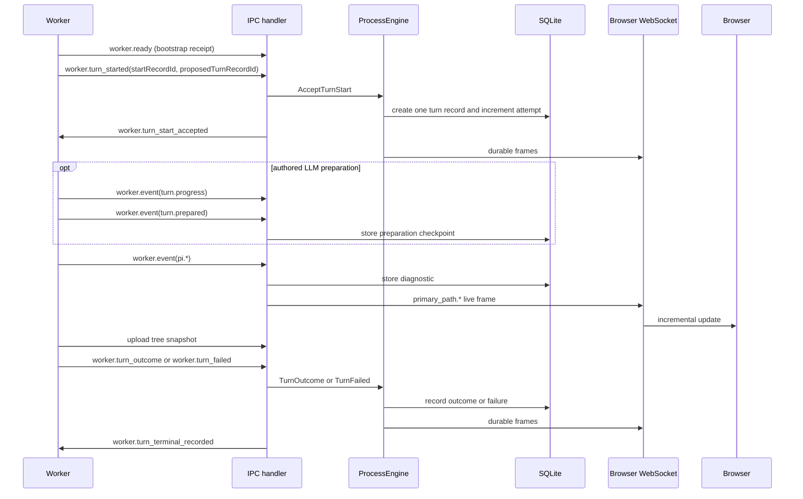

# LLM turn flow

A person watching a model write a plan sees text arrive before the plan is finished. The worker sends that activity as `worker.event` messages so the browser can show progress. Finishing the step takes a separate exchange. The worker uploads the session snapshot and reports the outcome. The server records the outcome before acknowledging it.

The sequence starts after the server has reserved a turn. For how a reservation becomes an attempt, see [Server and worker lifecycle](server-worker-lifecycle.md#when-a-start-becomes-an-attempt).

## Sequence

Before acceptance, LLM bootstrap may inspect the retained session tree to produce `preparedStart` without prompting Pi or mutating the tree. After acceptance, `worker.turn_start_accepted` is sent once the durable commit and lock release complete, and execution uses that recorded fork provenance. Tree snapshot upload must succeed before `worker.turn_outcome` / `worker.turn_failed`; upload failures become infrastructure failures. A server rejection or exception when recording a terminal fact becomes an infrastructure turn failure preserving any produced result entry and continuation metadata for Continue and Retry, and terminal recording retains the admitted lease ID so late failures cannot park a newer start. Session-global Pi events and unknown SDK events are stored as `worker.trace`, not turn-local `pi.*` activity.

## Preparation phase

A process can gate startup on [readiness](../extensions/launchers-and-readiness.md) or arm an external action while it waits.

Before allocation, the server applies model requirements and resolves the profile independently of availability. It then checks cached readiness. Preparation captures the profile and execution options atomically before yielding. Unavailable selections block without failover; an unaccepted start is not an attempt. See [model selection](../admin/models.md#profile-resolution).

An LLM turn may declare deterministic `.prepare(ctx)`. After start acceptance and before prompt evaluation, the worker runs preparation with access only to the turn's authorized integration tools, `ctx.reportProgress(...)`, `ctx.reportDiagnostic(...)` (`worker.trace`), and the captured `ctx.scopedSettings` snapshot. Its bounded, non-secret JSON output (`turn.prepared`) is passed to `.buildPrompt(ctx)` as `ctx.prepared`.

- Only the first valid `turn.prepared` checkpoint is stored per attempt; crashes before receipt re-run deterministic preparation, whereas replacement workers and Continue reuse the stored checkpoint for the same `turnRecordId` and Retry runs preparation again.
- Preparation failures park the owning turn in `error` without prompting Pi.
- An optional `.askQuestions(ctx => boolean)` predicate runs after preparation using captured params, state, and `ctx.prepared`; when false, `ask_questions` and its prompt guidance are omitted.
- An `executionPurpose` binding exposes declared non-secret `ctx.scopedSettings` values without injecting instructions into the worker system prompt.

## Mapped LLM turns

Entering a mapped LLM turn freezes an ordered item list in a durable run; see [Mapped LLM turns](../extensions/process-sdk.md#mapped-llm-turns). Items execute sequentially, each with its own `TurnStartRecord` and `ProcessTurnRecord`. Each item result commits atomically with the next item's start or, after the final item, with `.collect(...)` and the outgoing route. Workers receive only the active item.

An optional outcome-validation callback runs in the worker before outcome acceptance. Validation errors or schema rejections end the current Pi model/tool loop and trigger bounded worker recovery with the error feedback (server outcome checks remain authoritative). `abort_turn({ reason })` bypasses outcome validation and ends the turn via `worker.turn_failed` (`llm_error`) so Continue and Retry remain available.

## Recorded execution inspection

After acceptance, each Pi model call records an immutable revision containing the effective model, ordered messages, assembled system prompt, appended instructions, managed context files, and available tool definitions (excluding wire provider options and unrecorded workspace files; delivered secrets are redacted).

- Compaction, Continue, and worker replacement preserve earlier revisions.
- Supplied products record their producer and version and mark consumed reads.
- Session entry identities link committed messages to live activity when exposed by Pi; missing historical evidence remains explicitly `not_recorded` or `unavailable` rather than being reconstructed from current definitions.

## Browser rebuild

Process detail uses three HTTP/WS surfaces:

1. `GET /api/processes/:instanceId/ui-snapshot` for authoritative initial and reconnect state.
2. `primary_path.*` frames for live updates.
3. `GET /api/processes/:instanceId/turn-records/:turnRecordId/inspection?section=summary|trace|context|configuration` for expanded inspection.

Event ingestion atomically persists each event, its monotonic sequence, and a compact turn summary (at most 1,024 characters each of recent reasoning and assistant text, current tool status, counts, usage, and `throughEventSequence`, without full tool payloads). Initial page loads read compact summaries rather than replaying full event logs or parsing JSONL trees. Expanded live traces load all recorded activity for the `turnRecordId`, buffer incoming `pi.*` frames during async fetches, and deduplicate by `eventSequence`.
